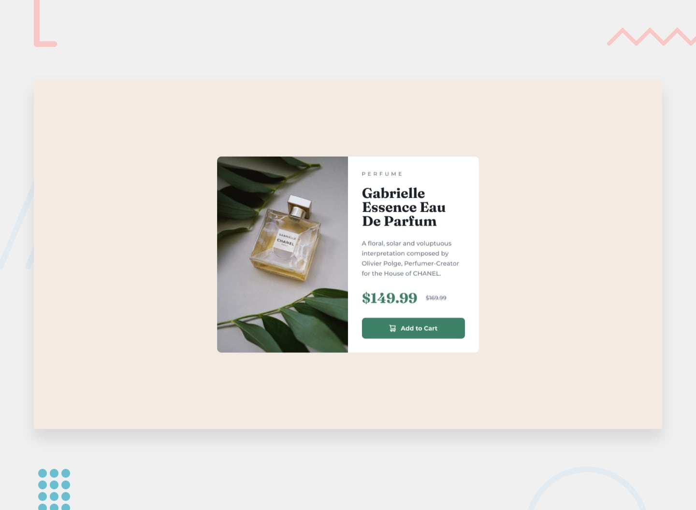

[Frontend Mentor](https://www.frontendmentor.io)projects provide by Frontend Mentor

This project is a product card that will change orientation depending if it on desktop or mobile. The mean take away of this project refining what I already know

### Solution Links

- Solution URL: [EBrown2124/product-preview-card-component](https://github.com/EBrown2124/product-preview-card-component)
- Live Site URL: [EBrown2124/product-preview-card-component](https://your-live-site-url.com)

### Built with

- Semantic HTML5 markup

- CSS custom properties

- Flexbox

### WHAT LEARN AND USED

```CSS

.element{
    width: calc();
}


### Links
- Github - [EBrown2124](https://github.com/EBrown2124)
- Frontend Mentor - [@EBrown2124](https://www.frontendmentor.io/profile/EBrown2124)